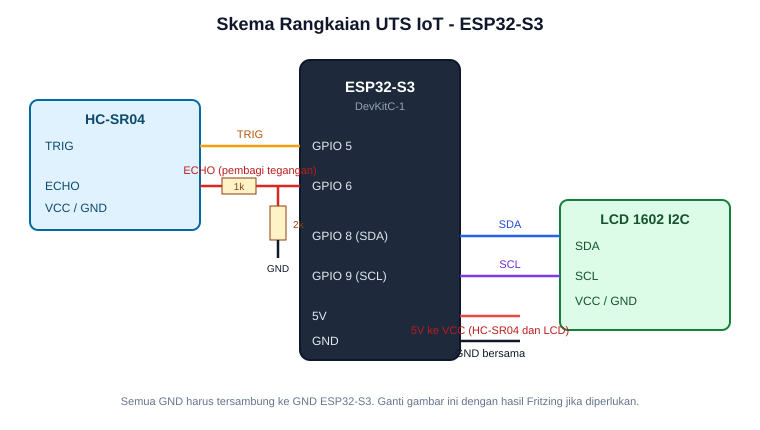

# UTS IoT - Monitoring Jarak Realtime dengan ESP32-S3

Sistem IoT berbasis **ESP32-S3** yang membaca jarak memakai sensor **HC-SR04**, menampilkannya di **LCD 1602 I2C**, dan mengirimkannya ke **dashboard web realtime**. Koneksi WiFi diatur lewat **captive portal** (WiFi provisioning), sehingga SSID dan password tidak perlu ditulis di dalam kode.

## Fitur

- Pembacaan jarak HC-SR04 yang stabil: median 5 sampel lalu dihaluskan dengan EMA, nilai di luar 2-400 cm dibuang
- Sampling sekitar 33 kali per detik, dashboard menarik data tiap 100 ms
- Tampilan jarak dan status jaringan langsung di LCD 1602 I2C
- WiFi provisioning lewat captive portal (mode AP + STA), kredensial tersimpan di flash
- Scan WiFi/hotspot otomatis tiap 15 detik, jaringan baru langsung muncul di daftar
- Daftar WiFi hanya diperbarui saat ada perubahan, jadi halaman tidak refresh dan posisi scroll tetap
- Dashboard terkunci sampai ESP32 mendapat IP STA dan online
- Dashboard jarak realtime dengan bar dan grafik 12 detik terakhir

## Komponen

| Komponen | Jumlah | Keterangan |
|---|---|---|
| ESP32-S3 DevKitC-1 | 1 | Mikrokontroler utama |
| Sensor ultrasonik HC-SR04 | 1 | Pengukur jarak |
| LCD 1602 + modul I2C | 1 | Alamat I2C `0x27` (alternatif `0x3F`) |
| Resistor 1 kOhm dan 2 kOhm | 1 + 1 | Pembagi tegangan jalur ECHO |
| Kabel jumper dan breadboard | secukupnya | |

## Wiring

| Perangkat | Pin perangkat | Pin ESP32-S3 |
|---|---|---|
| HC-SR04 | VCC | 5V |
| HC-SR04 | GND | GND |
| HC-SR04 | TRIG | GPIO 5 |
| HC-SR04 | ECHO | GPIO 6 (lewat pembagi tegangan) |
| LCD I2C | VCC | 5V |
| LCD I2C | GND | GND |
| LCD I2C | SDA | GPIO 8 |
| LCD I2C | SCL | GPIO 9 |

**Penting:** pin ECHO HC-SR04 mengeluarkan 5V, sedangkan GPIO ESP32-S3 hanya toleran 3,3V. Pakai pembagi tegangan 1 kOhm dan 2 kOhm. Detailnya ada di [`docs/pin-mapping.md`](docs/pin-mapping.md).

Diagram rangkaian: [`wiring/wiring.svg`](wiring/wiring.svg)



## Struktur Repositori

```
uts-iot-esp32/
├── src/
│   └── main.cpp              # firmware utama (HTML portal & dashboard ada di dalamnya)
├── wiring/
│   └── wiring.svg            # skema rangkaian
├── docs/
│   └── pin-mapping.md        # tabel pin dan pembagi tegangan
├── media/                    # foto rangkaian, screenshot, video demo
├── platformio.ini
├── .gitignore
└── README.md
```

## Cara Menjalankan

### PlatformIO (disarankan)

1. Buka folder `uts-iot-esp32` di VS Code dengan ekstensi PlatformIO.
2. Colokkan ESP32-S3, lalu klik **Upload**. Library `LiquidCrystal_I2C` terpasang otomatis dari `platformio.ini`.
3. Buka **Serial Monitor** (115200) untuk melihat IP.

### Arduino IDE

1. Pasang board **esp32 by Espressif** (Boards Manager), pilih **ESP32S3 Dev Module**.
2. Pasang library **LiquidCrystal_I2C** (marcoschwartz) lewat Library Manager.
3. Buat folder `uts_iot`, simpan isi `src/main.cpp` sebagai `uts_iot/uts_iot.ino`, lalu Upload.

### Setelah menyala

1. Sambungkan HP/laptop ke WiFi **ESP32-Setup** (tanpa password). Captive portal terbuka otomatis, atau buka `http://192.168.4.1`.
2. Pilih jaringan dari daftar (daftar diperbarui otomatis), isi password, tekan **Hubungkan**.
3. Setelah ESP32 mendapat IP STA, tombol **Buka Dashboard** aktif. IP juga tampil di baris kedua LCD.
4. Dashboard bisa dibuka dari jaringan WiFi yang sama di `http://<IP-ESP32>/dashboard`.

## Cara Kerja Singkat

1. HC-SR04 mengirim pulsa ultrasonik, ESP32 menghitung jarak dari lama pantulan (`pulseIn`).
2. Lima pembacaan terakhir diambil mediannya untuk membuang lonjakan, lalu dihaluskan dengan EMA.
3. Nilai ditampilkan di LCD dan disajikan lewat endpoint `/api/distance` yang ditarik dashboard tiap 100 ms.
4. Endpoint dan halaman dashboard menolak akses (403 / redirect ke portal) selama ESP32 belum online.

## Endpoint

| Path | Fungsi |
|---|---|
| `/` | Halaman captive portal |
| `/scan` | Daftar WiFi hasil scan (JSON) |
| `/status` | Status koneksi (JSON) |
| `/connect` | Simpan dan sambung ke WiFi (POST) |
| `/dashboard` | Dashboard jarak (terkunci jika belum online) |
| `/api/distance` | Data jarak terbaru (JSON) |

## Dokumentasi

- Foto dan demo: folder [`media/`](media/)
- Laporan: tambahkan ke folder `docs/` bila diperlukan

## Pembuat

Nama: `__________`
NIM: `__________`
Mata kuliah: Internet of Things
